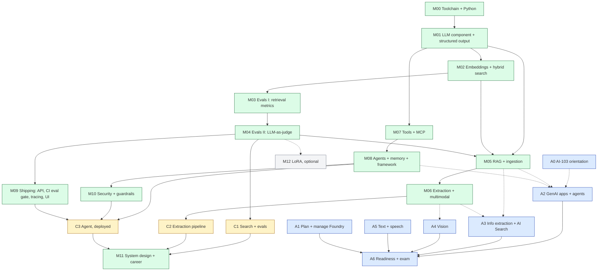

# Curriculum

Skill-building, bottom-up. **You build, the mentor scaffolds and reviews.** Every module ends with a measured number. Sessions ≤2h; a module spans several sessions (`/aie-checkpoint` in between).

Per module: **Why** (what breaks in a real product without it) · **Targets** · **Lab → metric** · **Read** · **Concept link** (optional, real system you know) · **Self-check** · **Cross-refs** · **AI-103** · **Est.**

Guide paths below are relative to `references/ai-system-design-guide/`. "Evals guide" = `ai_evals_comprehensive_study_guide.md` in that folder (chapter numbers verified 2026-11-04).

## Dependency graph

## Sequence rationale
- **Evals before RAG/agents.** You can't improve what you can't measure; every later module reuses the M03/M04 harness.
- **Structured output in M01.** Judges (M04), extraction (M06) and tools (M07) all depend on schema-valid output.
- **Search before RAG.** RAG quality is mostly retrieval quality; M02–M04 isolate retrieval so M05 can focus on generation + grounding.
- **AI-103 paired, not front-loaded.** 50–65% of the exam (GenAI/agents, vision, extraction) is learned in M05–M08 first; Azure specifics are then a bridge, not new theory.
- **Shipping + security after agents.** They harden things that already work.
- **Short on time?** Minimum spine: M00 → M01 → M02 → M03 → M04 → M05 → M07 → M08 → M10.

---

## Phase 1 — Foundations & evals

### M00 — Orientation, toolchain, Python for TS devs
**Why.** Every later lab depends on a fast, reproducible setup and a client that records cost and latency from day 1.
**Targets.**
1. `labs/` as a uv project + git repo, opened in PyCharm with the uv interpreter.
2. Python for a TS dev: typing, dataclasses vs pydantic models, async/httpx, pytest + fixtures, packaging — mapped to TS equivalents.
3. Ollama as an OpenAI-compatible server; models: `qwen3:8b` (chat), `gpt-oss:20b` (judge), `nomic-embed-text` (embeddings).
4. Postgres + pgvector in Docker (needed in M02).
5. Baselines: AI-103 free practice assessment (cold) + self-rating per curriculum area.
**Lab → metric.** `common/llm.py`: provider-agnostic chat + embed client that appends one JSONL line per call (model, provider, input/output tokens, latency ms, est. cost). Smoke test against Ollama. → **metric: p50 latency of 10 chat calls; tokens/sec.**
**Read.** uv docs (projects, `uv add`, `uv run`); pydantic "Models" concepts; pytest fixtures; Ollama OpenAI-compatibility doc.
**Self-check.** Can you swap Ollama for Azure OpenAI by changing only env vars? Where would a per-call cost number come from for a local model (hint: there isn't one — what do you log instead)?
**Cross-refs.** All modules use `common/llm.py`.
**Est.** ~5h (2 sessions + Python ramp).

### M01 — LLMs as an engineering component + structured output
**Why.** Treating the model as a black box gives you random latency, flaky outputs and broken parsers in production.
**Targets.**
1. Tokens, context window, sampling (temperature, top-p), why "temperature 0" is not fully deterministic.
2. Latency anatomy: time-to-first-token vs throughput; what a cost model looks like for hosted vs local.
3. Structured output: JSON schema, pydantic validation, Ollama `format`, retry-on-validation-error, when to use tool calling instead.
**Lab → metric.** (a) 45-min experiment: same prompt ×20 at 3 temperatures → output-variance + TTFT. (b) Structured extractor: free-text travel listings → pydantic model, with validation + bounded retry. → **metrics: TTFT p50, schema-valid % (with/without retry).**
**Read.** Huyen *AI Engineering* ch. 1–2 (skip formulas); guide `01-foundations/02-tokenization-deep-dive.md`, `01-foundations/06-inference-pipeline.md`, `05-prompting-and-context/06-structured-generation.md`. Optional: Anthropic Academy "Building with the Claude API" (concepts transfer to any provider).
**Self-check.** Why do retries raise cost but rarely latency p50? When is schema-constrained decoding better than "please reply in JSON"?
**Cross-refs.** M04 (judge verdicts as schema), M06 (extraction), M07 (tool arguments).
**AI-103.** Feeds A2 (structured outputs, Responses API).
**Est.** ~4h.

### M02 — Embeddings & hybrid search
**Why.** Keyword search misses meaning ("romantic overwater villa" → 0 hits); vector search misses exact names and typos. Products need both.
**Targets.**
1. Embeddings & cosine similarity — **write cosine by hand** before using numpy/pgvector.
2. Exact KNN vs ANN (HNSW, IVFFlat); when an index helps (you measured: 2.4k rows exact = 13 ms).
3. Postgres full-text (tsvector, prefix queries) + trigram for typos.
4. Hybrid fusion: **write RRF by hand**; why rank fusion beats score mixing (score compression, measured with ada-002: 0.76–0.85 band).
5. Pre-filtering vs post-filtering by metadata (category tabs).
**Lab → metric.** Hybrid search over a public travel dataset (e.g. Wikivoyage extracts or Inside Airbnb listings — licence checked in lab spec) in Postgres + pgvector: lexical, vector, hybrid endpoints + metadata filter. → **metrics: p50 query latency per mode; qualitative top-5 for 10 fixed queries.** Publish README with these numbers (milestone 2).
**Read.** guide `01-foundations/05-embeddings-and-vector-spaces.md`, `06-retrieval-systems/03-embedding-models.md`, `04-vector-databases.md`, `05-hybrid-search.md`; pgvector README.
**Concept link.** GTCOne supplier hybrid search (PR1): lexical + vector + RRF + category prefilter + 800 ms embedding budget — compare your design.
**Self-check.** Why does a category filter applied after a global top-K starve small categories? When would you add an HNSW index?
**Cross-refs.** M03 measures this; M05 reuses retrieval.
**AI-103.** A3 (semantic/hybrid/vector search in Azure AI Search).
**Est.** ~6h.

### M03 — Evals I: error analysis & retrieval metrics
**Why.** "It looks better" isn't evidence. Without a golden set you can't tune, compare models, or defend a launch.
**Targets.**
1. Error analysis: read outputs, open coding → axial coding → prioritise by frequency × severity.
2. Golden sets: query selection, graded vs binary relevance, labeling cost.
3. Metrics **written by hand first** (~15 lines each): precision@k, recall@k, MRR, nDCG@k. Then ranx to confirm.
4. Comparing systems fairly: same queries, same k, baseline, small-sample caveats.
**Lab → metric.** Eval harness: (a) BEIR SciFact subset (has relevance labels) to validate your metric code against ranx; (b) 30-query self-labeled set on your M02 travel data (≈2h labeling budgeted). Compare lexical / vector / hybrid. → **metric: nDCG@10 per mode on both sets.**
**Read.** Evals guide ch. 1 (what evals are), ch. 3 (error analysis), ch. 6 (RAG/retrieval evaluation); guide `06-retrieval-systems/13-rag-evaluation-patterns.md`; ranx README.
**Self-check.** Why can MRR look great while nDCG@10 is poor? What does a 0.03 nDCG gain on 30 queries actually tell you?
**Cross-refs.** M04 automates labeling; C1 publishes.
**Est.** ~6h (+2h labeling).

### M04 — Evals II: LLM-as-judge & regression gates
**Why.** Human labels don't scale; an unvalidated LLM judge silently lies. Teams that ship AI weekly gate changes on calibrated judges.
**Targets.**
1. Binary judges with structured verdicts (reuse M01).
2. Train/dev/test split of human labels; **TPR/TNR written by hand**; iterate the judge prompt on dev only.
3. Correcting judge bias (judgy) and reporting a corrected rate with an interval.
4. Regression gate: pytest that fails when the metric drops below a threshold.
5. Stretch: inter-annotator agreement (kappa) with a second labeler.
**Lab → metric.** Relevance judge (`gpt-oss:20b`) labeling (query, result) pairs; validate against your M03 labels. Optional: compare with a hosted model (if API credit). → **metrics: judge TPR/TNR on test split; corrected relevance rate.**
**Read.** Evals guide ch. 4 (LLM-as-judge), ch. 10 (judgy), ch. 11 (closing the loop/regression), ch. 12 (human annotation); judgy README.
**Self-check.** Why is raw "agreement" misleading when failures are rare? What's leakage when you tune the judge on the test split?
**Cross-refs.** M05/M06/M08 reuse the judge pattern; M09 runs the gate in CI.
**AI-103.** A2 (evaluation in Foundry) — bridge later.
**Est.** ~6h.

### C1 — Capstone: search + evals (public)
**Deliverable.** `labs/capstones/c1-search-evals`: hybrid search + eval harness + judge + regression test; README with a metrics table (lexical vs vector vs hybrid, nDCG@10, judge TPR/TNR, latency), decisions and limitations. Write-up #1 (blog/LinkedIn/dev.to). Stretch: cross-encoder reranker and its nDCG/latency trade-off.
**Gate.** `/aie-review` avg ≥4; numbers reproducible from a clean clone.
**Est.** ~6h.

### A0 — AI-103 orientation (light, ~1h/week in Phase 1)
Learn path "Get started with AI applications and agents on Azure"; module "Plan and Prepare to Develop AI Solutions on Azure"; read the AI-103 study guide skill list once. No exam prep yet.

---

## Phase 2 — Building systems + AI-103

### M05 — RAG & ingestion
**Why.** Most RAG failures are ingestion and retrieval failures that look like model failures.
**Targets.** Parsing & chunking strategies · incremental re-indexing (hashes, idempotency) · embedding-model migration (re-embed plan, dual-read) · reranking · grounded answers with citations · faithfulness & citation-accuracy evals · basics of multi-turn evaluation.
**Lab → metric.** RAG over a public document set with citations; judge for faithfulness; retrieval metrics reused from M03. → **metrics: citation accuracy, faithfulness pass rate, retrieval nDCG@10.**
**Read.** Huyen ch. 6; guide `06-retrieval-systems/01-rag-fundamentals.md`, `02-chunking-strategies.md`, `06-reranking-strategies.md`, `10-contextual-retrieval.md`, `14-production-rag-at-scale.md`; evals guide ch. 8 (multi-turn).
**Concept link.** GTCOne Atlas: fan-out retrieval across many sources + citation markers + content-hash re-embedding.
**Self-check.** When does a reranker beat a better embedding model? How do you re-embed 100k docs without downtime?
**AI-103.** A2 (RAG in Foundry), A3 (indexing, grounding).
**Est.** ~7h.

### M06 — Document extraction & multimodal
**Why.** Turning PDFs/images into reliable structured data is one of the highest-ROI AI uses — and the easiest to get silently wrong.
**Targets.** OCR & layout vs vision-LLM extraction · schema design · field-level accuracy · confidence & calibration (is "high confidence" actually right more often?) · human-review queues · cost per document.
**Lab → metric.** Extraction pipeline on a public invoice/receipt dataset (licence checked in spec) with a golden set. → **metrics: per-field accuracy, calibration table, cost/latency per doc.**
**Read.** guide `10-document-processing/01-ocr-and-layout.md`, `16-case-studies/10-document-intelligence.md`; reuse M01 structured output.
**Concept link.** GTCOne air rate-grid extraction (vision → rows, extraction status/confidence, locked human edits).
**Self-check.** How do you decide which fields need human review? Why is document-level accuracy a bad metric?
**AI-103.** A3 (Content Understanding, Document Intelligence), A4 (vision).
**Est.** ~6h.

### C2 — Capstone: extraction pipeline (public)
README with per-field accuracy, calibration, cost/doc; write-up #2. **Est.** ~5h.

### M07 — Tool use & MCP
**Why.** Models become useful when they can call your systems — and dangerous when tool design is sloppy.
**Targets.** Function/tool calling mechanics · tool design (names, schemas, error messages the model can act on) · MCP architecture (tools, resources, prompts; transports) · building a Python MCP server + client loop.
**Lab → metric.** MCP server exposing your M02 search (+ a filter tool); client agent loop calling it. → **metrics: tool-call error rate on 20 tasks; avg tool calls per task.**
**Read.** guide `07-agentic-systems/03-tool-use-and-mcp.md`; MCP docs (modelcontextprotocol.io); Anthropic Academy "Introduction to Model Context Protocol"; DeepLearning.AI "MCP: Build Rich-Context AI Apps with Anthropic" (optional).
**Concept link.** GTCOne Atlas uses Payload MCP + Sabre MCP tools with an allow-list and rejection telemetry.
**Self-check.** What makes a tool error message "model-actionable"? Why allow-list tool names at call time?
**AI-103.** A2 (tools in Foundry agents).
**Est.** ~5h.

### M08 — Agents, memory & frameworks
**Why.** Agents fail in loops, lose context, and burn money; knowing when *not* to build an agent is the senior skill.
**Targets.** Workflows vs agents · reasoning/act loops, stop conditions, recovery · human-in-the-loop approval · memory & state: short-term context, summaries, long-term memory, context-window budgeting · trajectory & task-success evals · hand-rolled loop first, then **Microsoft Agent Framework** (cert) and compare.
**Lab → metric.** Travel-research agent using your MCP tools, with HITL approval for one action, on 20 scripted tasks. → **metrics: task success rate, avg steps, cost & latency per task; framework vs hand-rolled delta.**
**Read.** Anthropic "Building effective agents"; Anthropic "Effective context engineering for AI agents"; guide `07-agentic-systems/01,02,07,08,10,11`, `08-memory-and-state/*`. Optional: Hugging Face Agents Course (certificate); Microsoft "AI Agents for Beginners".
**Concept link.** GTCOne supplier-admin agent; Foundry-hosted agents.
**Self-check.** Which of your 20 tasks should have been a workflow? Where does the context window overflow first?
**AI-103.** A2 (Foundry Agent Service, multi-agent orchestration).
**Est.** ~8h.

### AI-103 track (Phase 2) — via `/aie-cert`
| Domain (weight) | Paired with | Learn path |
|---|---|---|
| A2 GenAI + agents (30–35%) | M05, M07, M08 | Develop generative AI apps on Microsoft Foundry · Develop AI Agents on Azure |
| A3 Information extraction (10–15%) | M02, M05, M06 | Azure AI Search training modules; Content Understanding / Document Intelligence modules |
| A4 Computer vision (10–15%) | M06 | Develop computer vision solutions with Microsoft Foundry |
| A5 Text analysis incl. speech (10–15%) | — (cert-only) | from study-guide links (verify) |
| A1 Plan & manage (25–30%) | M00, M09 concepts | Plan and Prepare to Develop AI Solutions on Azure |
| A6 Readiness | all | practice assessment ≥80% twice, exam sandbox |

---

## Phase 3 — Production, security, career

### M09 — Shipping: API, CI eval gate, tracing, UI
**Why.** A notebook isn't a product. Production means latency budgets, fallbacks, observability and a gate that stops regressions.
**Targets.** FastAPI streaming endpoint · containerise · rate limits & timeouts & fallbacks · caching (exact + semantic) · model routing · **CI eval gate** (GitHub Actions running recorded responses) · OpenTelemetry GenAI tracing (Langfuse or Phoenix) · cost dashboard · **Next.js/TS front end** on one capstone (your home turf).
**Lab → metric.** Ship C1 or C2 as a service + UI. → **metrics: p95 latency, cost/request, cache hit rate, CI gate pass/fail on a deliberate regression.**
**Read.** Evals guide ch. 2 (observability), ch. 13 (cost & scaling evals); guide `11-infrastructure-and-mlops/02-cicd.md`, `03-ai-gateways-and-model-routing.md`, `04-finops-and-token-economics.md`, `14-evaluation-and-observability/02-observability.md`; Huyen ch. 9–10; FastAPI docs.
**Est.** ~8h.

### M10 — AI security & guardrails
**Why.** An agent with tools + private data + untrusted input is an exfiltration path by default.
**Targets.** OWASP Top 10 for LLM Applications 2026 + Top 10 for Agentic Applications · prompt injection (direct/indirect) · "lethal trifecta" (private data + untrusted content + external communication) · tool permissions & least privilege · PII redaction · content safety · red-team test suites.
**Lab → metric.** Injection/red-team suite against your M08 agent; add mitigations. → **metric: attack pass rate before vs after.**
**Read.** guide `05-prompting-and-context/08-prompt-injection-defense.md`, `12-security-and-access/*`, `13-reliability-and-safety/01-guardrails.md`; OWASP GenAI lists; Simon Willison on prompt injection.
**Concept link.** GTCOne: PII redaction before embedding, tool allow-list + rejection telemetry, agent runs as the calling user (RBAC).
**AI-103.** Responsible AI / content safety items.
**Est.** ~6h.

### C3 — Capstone: agent with evals, tracing, guardrails — deployed
Public repo + live demo + write-up #3. **Est.** ~8h.

### M11 — System design & career (ongoing)
Weekly `/aie-quiz-me design` from week 23; interview prep; portfolio polish; read guide `00-interview-prep/*`, `15-ai-design-patterns/*`, `16-case-studies/*` (pick 6).

### Optional
- **M12 — Model adaptation:** fine-tune vs prompt vs RAG; LoRA via mlx-lm on a small model vs prompt baseline (quality/cost/latency). Huyen ch. 7–8; guide `03-training-and-adaptation/02,03,05,06`.
- **S1 — Retrieval depth:** late interaction (ColBERT), contextual retrieval, learning-to-rank.
- **S2 — AI security specialty:** SC-500 (Cloud and AI Security Engineer Associate).
